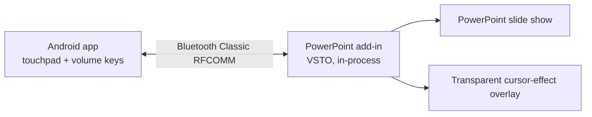

# PocketPresenter

**Turn your Android phone into a wireless presenter for Windows PowerPoint — over Bluetooth, with no extra Windows app.**

> **Project status: pre-implementation (Gate 0).** The product and architecture are fully specified; code starts with three feasibility proofs. Nothing here is released yet. See [Status and roadmap](#status-and-roadmap).

---

## What it does

PocketPresenter is an Android controller plus a PowerPoint add-in that runs *inside* PowerPoint.

- **Slides:** Volume Up = next slide, Volume Down = previous slide — including with the phone screen off on tested devices (*Pocket Mode*).
- **Trackpad:** use the phone as a wireless touchpad to move the real Windows cursor, click, drag and scroll.
- **Cursor effects:** a subtle, click-through overlay around the cursor with three live-switchable styles — *Honeycomb Pulse*, *Diamond Facets* and *Geometric Ripple* — or **Off**.
- **Draw Mode (planned):** annotate the current slide using PowerPoint's own slide-show drawing.
- **Private and offline:** Bluetooth Classic only. No cloud, accounts, Wi-Fi, analytics or internet.

## How it works



The add-in owns the Bluetooth link, slide commands, cursor input and the overlay. PowerPoint stays in charge of rendering your slides, so transitions, media and fonts behave exactly as usual, and your `.pptx` is never modified.

## Quick user flow (target experience)

1. Pair your phone with Windows once in **Settings → Bluetooth & devices**.
2. On the phone, open PocketPresenter and tap **Start session**.
3. In PowerPoint, open the **PocketPresenter** ribbon group and choose **Connect phone**.
4. Start your slide show as normal and present.

## Requirements (V1 target)

| | |
|---|---|
| Windows | Windows 10/11, 64-bit |
| PowerPoint | Desktop PowerPoint for Windows (Microsoft 365 / 2019+) |
| Phone | Android 12+ with Bluetooth Classic |
| Not supported in V1 | PowerPoint for the web, macOS, Linux, Google Slides |

Supported device combinations are listed only after they pass testing; see [the test matrix](tests/manual-test-matrix.md) and [Supported configurations](docs/architecture.md#18-supported-configurations).

## Known limitations

- Screen-off volume-button delivery depends on the Android version and phone maker; it is tested per device, never assumed.
- The cursor effect is drawn in a separate transparent window. It appears on a projector or a shared **full display**, but may not appear when a meeting app captures **only the PowerPoint window**.

## Repository layout

```text
pocketpresenter/
├── README.md                  You are here
├── PROJECT_SETUP.md           Dev environment and toolchain setup
├── AGENTS.md                  Entry point for AI coding agents
├── docs/                      The documentation pack (start at docs/README.md)
│   ├── prd.md                 Product requirements and acceptance targets
│   ├── architecture.md        System design, threat model, gates
│   ├── trd.md                 Stack, module boundaries, interfaces
│   ├── protocol.md            Phone ⇄ add-in wire protocol
│   ├── app_flow.md            Screens, states, error catalog, journeys
│   ├── ui_ux_brief.md         Visual language and interaction rules
│   ├── backend_schema.md      "No backend" decision and local data model
│   ├── implementation_plan.md Phased plan with task IDs and gates
│   ├── rules.md               Working rules for AI and human contributors
│   ├── decisions.md           Decision log (ADRs)
│   ├── feasibility-report.md  Gate 0 evidence log
│   └── traceability.md        Requirement → design → plan → test
├── protocol/fixtures/         Shared protocol test vectors (Kotlin + C#)
├── tests/manual-test-matrix.md  Hardware and device results
├── android/                   Kotlin + Jetpack Compose app   (to be built)
├── windows-addin/             VSTO / .NET Framework 4.8 add-in (to be built)
├── .github/                   Issue and pull request templates
├── CONTRIBUTING.md  SECURITY.md  CHANGELOG.md  LICENSE
└── .gitignore  .editorconfig  .gitattributes
```

## Status and roadmap

| Stage | Goal | State |
|---|---|---|
| **Gate 0** | Prove Bluetooth in the add-in, the click-through overlay, and screen-off volume buttons | ⏳ Not started |
| Wave 1 | Minimal usable controller (connect, next/previous, basic cursor) | Blocked on Gate 0 |
| Wave 2 | Production pointer (right click, scroll, drag, recovery) | Planned |
| Wave 3 | Three cursor effects | Planned |
| Wave 4 | Draw Mode and hardening (60-minute soak) | Planned |
| Wave 5 | Installer and release | Planned |

No feature wave starts until the previous gate passes. Task-level plan: [docs/implementation_plan.md](docs/implementation_plan.md).

## Documentation

Start with [docs/README.md](docs/README.md) for the reading order and canonical names. Highlights:

- [PRD](docs/prd.md) — what and why
- [Architecture](docs/architecture.md) — design, requirements, threat model, tests
- [Wire protocol](docs/protocol.md) — message formats, limits, error codes
- [Implementation plan](docs/implementation_plan.md) — phases, task IDs, definition of done
- [Feasibility report](docs/feasibility-report.md) — Gate 0 results template

## Getting started (contributors)

1. Read [docs/README.md](docs/README.md), then [docs/rules.md](docs/rules.md) and [CONTRIBUTING.md](CONTRIBUTING.md).
2. Set up your development environment using [PROJECT_SETUP.md](PROJECT_SETUP.md).
3. Pick up Gate 0 work: see [android/README.md](android/README.md) and [windows-addin/README.md](windows-addin/README.md).
4. Record every result in [docs/feasibility-report.md](docs/feasibility-report.md) and [tests/manual-test-matrix.md](tests/manual-test-matrix.md).

Using an AI coding tool? Point it at [AGENTS.md](AGENTS.md).

## Security

PocketPresenter lets a nearby device control a laptop, so it is designed around bonded, encrypted pairing and a strict allow-listed protocol with no remote-execution surface. To report a vulnerability, see [SECURITY.md](SECURITY.md).

## License

Released under the [MIT License](LICENSE).
