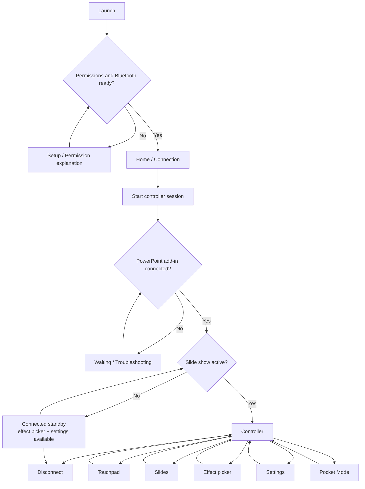
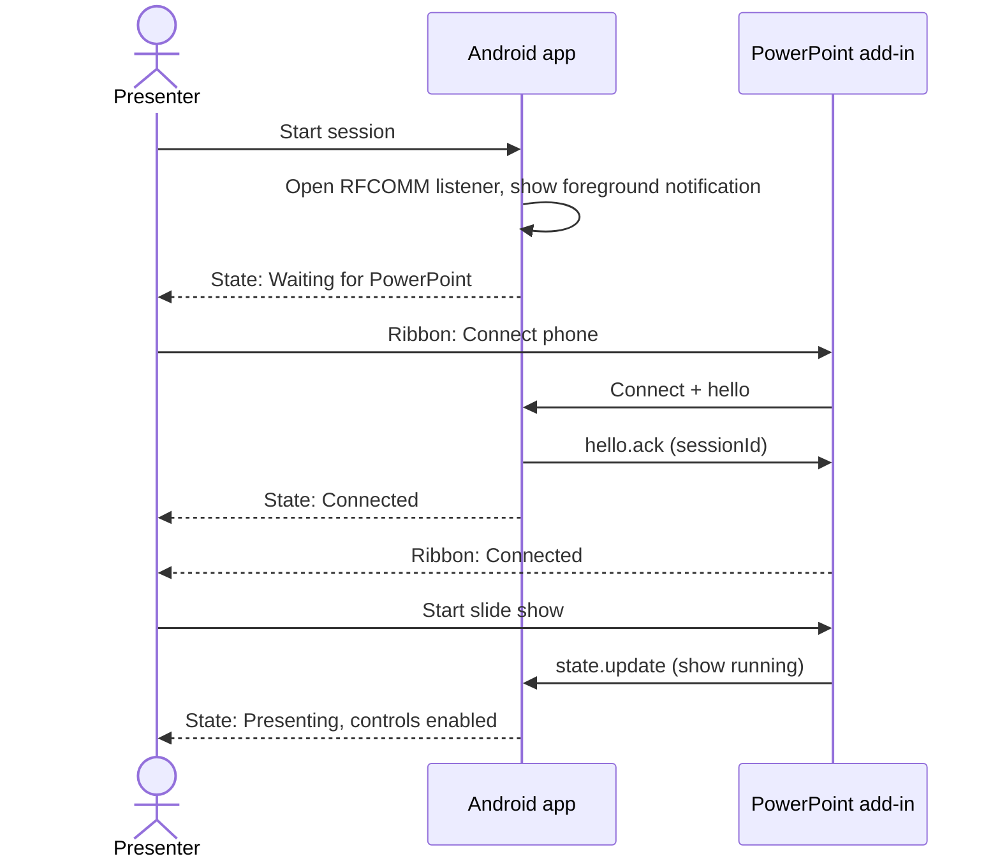
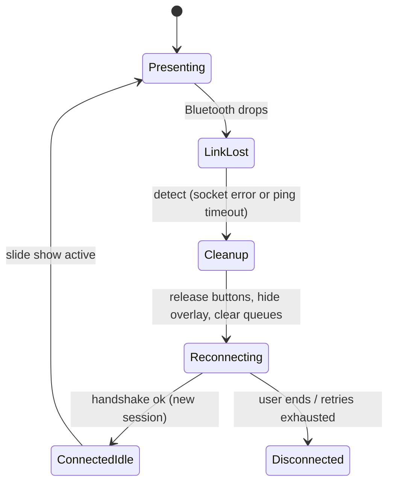

# PocketPresenter — App Flow Document

| | |
|---|---|
| **Version** | 1.1 |
| **Scope** | Android controller and the PocketPresenter controls embedded in desktop PowerPoint |
| **Source references** | [prd.md](prd.md) · [architecture.md](architecture.md) · [protocol.md](protocol.md) |

## Table of contents

1. [Navigation model](#1-navigation-model)
2. [Screens and responsibilities](#2-screens-and-responsibilities)
3. [State-driven controls](#3-state-driven-controls)
4. [Error and recovery catalog](#4-error-and-recovery-catalog)
5. [Core user journeys](#5-core-user-journeys)
6. [State-machine rules](#6-state-machine-rules)
7. [Revision history](#7-revision-history)

## 1. Navigation model

The Android app has a small number of purposeful screens. The default path should take a first-time user from setup to controlling a slideshow with minimal steps.

*Clarification in v1.1:* the Controller screen is visible whenever the link is connected, but touchpad and slide controls are enabled only while a slide show is active (see [§3](#3-state-driven-controls)). In connected standby the user can still choose an effect and open settings, so the choice is ready when the show starts.

### Connect sequence

## 2. Screens and responsibilities

### Screen A — First launch / setup

**Purpose:** Explain the required setup without overwhelming the user.

Content:
- One sentence describing that PocketPresenter controls desktop PowerPoint over Bluetooth.
- Requirements: Windows desktop PowerPoint with PocketPresenter add-in, Bluetooth pairing, and Android permissions required by the OS.
- `Continue` action.

Interactions:
- `Continue` checks Bluetooth capability and proceeds to permission setup.
- Explain each permission immediately before requesting it.
- If the device cannot support required Bluetooth functionality, show the reason and a non-blocking exit path.

### Screen B — Bluetooth and permissions

**Purpose:** Get the phone ready for a session.

Content:
- Bluetooth status.
- Permission status with a `Grant permission` action.
- `Open Bluetooth settings` action.
- Short explanation that OS pairing is completed in Android/Windows Bluetooth settings.

States:
- Bluetooth disabled.
- Permission missing.
- Bluetooth unavailable.
- Ready.

Do not continually prompt after the user declines permission. Show the specific settings path for recovery where possible.

### Screen C — Home / Connection

**Purpose:** Start or end the Bluetooth controller session.

Content:
- Connection state label (see [§3](#3-state-driven-controls)).
- `Start session` / `End session` button.
- Effect preview and currently selected effect.
- Help link for connecting from PowerPoint's PocketPresenter ribbon.

Behavior:
- `Start session` starts the RFCOMM service/listener and the user-visible foreground session if required by Android.
- When a PowerPoint add-in handshake succeeds, show the PC name if available and mark the session connected.
- Do not enable pointer/slide controls before protocol negotiation completes.
- `End session` confirms if a drag/draw operation is active, then releases state and closes the connection.

### Screen D — Controller (main screen)

**Purpose:** Provide immediate access to touchpad, slides and effect selection.

Structure:
- Header: connection indicator and connected computer.
- Mode selector: `Touchpad`, `Slides`.
- Main interaction surface.
- Effect strip with `Honeycomb`, `Diamond`, `Ripple` and `Off`.
- Compact Settings action.

Behavior:
- Effect changes send `effect.set` immediately; do not require reconnection.
- When connection is lost, disable misleading active controls and display a clear reconnect state.
- Preserve the user's last chosen effect and sensitivity locally.

### Screen E — Touchpad mode

Controls:
- Large touch-sensitive surface.
- Left-click and right-click controls (visible fallback buttons).
- Scroll mode/gesture hint.
- Optional drag lock, disabled by default.
- Sensitivity shortcut.

Gesture specification:

| Gesture | Action | Notes |
|---|---|---|
| One-finger movement | Move pointer | Direct; never eased or delayed by animation. |
| Single tap | Left-click | |
| Two-finger tap | Right-click (primary mapping) | Visible right-click button remains as an accessible fallback. Primary choice to be confirmed in usability testing (PQ3). |
| Two-finger vertical movement | Scroll | |
| Long press + move | Drag | Only if the gesture state machine reliably separates it from a tap; otherwise the explicit drag lock is the drag mechanism. |
| System touch cancellation / session loss | Release all mouse buttons | Always. |

Avoid making the honeycomb touch feedback slow down or quantize pointer movement.

### Screen F — Slides mode

Controls:
- Large `Previous` and `Next` buttons.
- Status of the active PowerPoint slide show.
- `End slide show` only if safe and explicitly supported.
- Short reminder: Volume Up = Next; Volume Down = Previous.

Behavior:
- On-screen slide commands are available as fallback while the phone screen is on.
- At the end of a slide deck, show or accept the native PowerPoint result instead of claiming the slide changed.
- The user must not be required to stay on this screen for physical volume-button commands to be delivered, subject to Android behavior validated on the device.

### Screen G — Effect selector

Effects:
1. **Honeycomb Pulse:** connected hexagons, small depth/edge highlight.
2. **Diamond Facets:** clean diamond/rhombus lattice.
3. **Geometric Ripple:** two or three restrained geometric contours.
4. **Off:** standard cursor without the custom effect.

Controls:
- Preview swatch/miniature.
- Intensity slider with a low, subtle default.
- Effect size slider only if needed after initial usability tests.
- `Apply` should not be required; selection updates live.

Switching effects must preserve pointer position and not interrupt the active slide show. Available in connected standby as well as while presenting.

### Screen H — Pocket Mode

**Purpose:** Keep physical slide controls available while the screen is off on supported devices.

Entry flow:
1. User taps `Pocket Mode` while the session is connected.
2. Display a short confirmation explaining that touchpad interaction is unavailable with the screen off and volume-button handling depends on device support. Show whether this device is **validated**, **not validated** or **unsupported**.
3. Start/verify the active session, then allow the display to turn off or the app to be left in the background as implemented.
4. Volume Up sends next; Volume Down sends previous if the device delivers these events.

Exit flow:
- Wake the screen and return to the app, then disable Pocket Mode.
- If the connection is lost, show the lost state when the app is visible and do not queue old slide commands.
- Do not claim this works after Android force-stop or on every manufacturer's device.

### Screen I — Settings

Settings:
- Pointer sensitivity and optional acceleration.
- Scroll speed.
- Haptic feedback on/off.
- Effect intensity and reduced motion.
- Left-handed layout.
- Connection diagnostics.
- Clear pairing/session metadata.
- About, supported-device information and privacy.

Avoid account setup, themes unrelated to the controller, online sync and analytics in V1.

### PowerPoint ribbon / status UI

Ribbon group:
- `Connect Phone` / `Disconnect`.
- Connection indicator.
- `Effect Preview` or settings entry if needed.
- `Troubleshoot` / local diagnostics.

PowerPoint status states:
- Not connected.
- Phone connected; slide show not active.
- Controlling active slide show.
- Unsupported slide-show configuration.
- Bluetooth disconnected/reconnecting.
- Overlay unavailable.

The add-in may create an internal transparent overlay window for rendering. It must not start an independent companion executable or appear as a second application the user must manage.

## 3. State-driven controls

One canonical state model drives every screen. UI labels differ from internal state names, but the mapping is fixed. Internal names come from [architecture.md §12](architecture.md#12-state-model).

| Internal state | Phone label | Ribbon label | Touchpad / Slides | Volume keys | Effect picker | Overlay |
|---|---|---|---|---|---|---|
| `Disconnected` | Not connected | Not connected | Disabled | Do not send | Enabled (local preference only) | Hidden |
| `PhoneReady` | Waiting for PowerPoint | Not connected | Disabled | Do not send | Enabled (local only) | Hidden |
| `Connecting` | Connecting… | Connecting… | Disabled | Do not send | Enabled (local only) | Hidden |
| `ConnectedIdle` | Connected — start the slide show | Phone connected; no slide show | Disabled, with explanation | Do not send | Enabled, sent live | Hidden |
| `PresentingArmed` | Presenting | Controlling slide show | Enabled | Send | Enabled, sent live | Visible |
| `Disconnecting` | Ending session… | Disconnecting… | Disabled | Do not send | Disabled | Hidden |
| link lost / retry | Reconnecting… | Disconnected, reconnecting | Disabled; never queue input | Do not send; do not queue | Local only | Hidden |
| error | Error + recommended action | Error + recommended action | Disabled | Do not send | Local only | Hidden |

Rules:
- Labels are text, with an icon; never color alone.
- "Reconnecting" and "Error" are presentation states layered on the internal state machine (`link lost` with bounded retry). They never imply that control is active.

## 4. Error and recovery catalog

Every error shows **one recommended next action**. Never show raw stack traces. Protocol codes are defined in [protocol.md §6](protocol.md#6-error-codes).

| Condition | Where | Message (sentence case) | Recovery action |
|---|---|---|---|
| Bluetooth is off | Phone | Bluetooth is off. | `Turn on Bluetooth` → system dialog / settings |
| Bluetooth permission denied | Phone | PocketPresenter needs Bluetooth permission to connect to your PC. | `Grant permission` |
| Permission permanently denied | Phone | Bluetooth permission is turned off for this app. | `Open app settings` (no repeated prompts) |
| Device lacks Bluetooth Classic | Phone | This phone can't use Bluetooth Classic, which PocketPresenter needs. | Exit path; link to supported devices |
| No PC pairing found | Phone | Pair your phone with your PC first. | `Open Bluetooth settings` |
| Foreground session blocked by OS | Phone | Android didn't allow the session to start in the background. | `Open PocketPresenter` and tap `Start session` |
| PowerPoint did not connect within timeout | Phone | Waiting for PowerPoint. | Show: "In PowerPoint, open PocketPresenter → Connect phone." |
| Protocol version mismatch (`BAD_VERSION`) | Both | The phone app and PowerPoint add-in versions don't match. | `Update` the older component |
| No slide show (`NO_ACTIVE_SLIDESHOW`) | Phone | No slide show is running. | "Start the slide show in PowerPoint." |
| Not armed (`NOT_ARMED`) | Phone | Control is paused. | Return to slide show window / reconnect |
| Link lost during session | Both | Connection lost. | Auto-retry (bounded) + `Reconnect now` |
| Screen-off volume not validated on this phone | Phone | Volume buttons may not work with the screen off on this phone. | Keep on-screen controls; link to supported devices |
| Overlay unavailable | Ribbon | Cursor effect isn't available right now. | Continue without effect; `Troubleshoot` |
| Add-in disabled by Office | PowerPoint | PocketPresenter is turned off in PowerPoint. | Repair/enable steps in troubleshooting |

## 5. Core user journeys

### Journey 1 — First setup

1. Install the Android controller.
2. Install/trust the PowerPoint add-in using the documented deployment path.
3. Pair the devices in OS Bluetooth settings.
4. Open PowerPoint and enable/connect PocketPresenter from the ribbon.
5. Start the Android session and complete the handshake.
6. Run the input test and confirm commands work.

### Journey 2 — Present and switch effect

1. Open the existing PPTX and start the slide show.
2. Open the Android controller and confirm `Presenting`.
3. Move finger to move the Windows cursor.
4. Tap `Honeycomb`, then `Diamond`, then `Ripple`, then `Off`.
5. Verify the cursor remains in place and slide content is not obstructed.

### Journey 3 — Use volume buttons with screen off

1. Connect and start the presentation.
2. Enable Pocket Mode.
3. Turn off the phone screen.
4. Press Volume Up, then Volume Down.
5. Verify exactly one next/previous command per press on the supported device.
6. Wake the phone and verify session state is correct.

### Journey 4 — Recover from disconnection

1. Break the Bluetooth connection during touch movement.
2. Verify the overlay hides and no mouse button remains pressed (within one second of detection, AT-04).
3. Reconnect manually or through bounded retry.
4. Verify no stale pointer movement/slide command is replayed.
5. Resume only after the connected state is shown.

## 6. State-machine rules

- Do not treat Bluetooth-paired as the same as application-connected.
- Do not treat application-connected as the same as an active slideshow.
- Do not display the overlay unless the session is authenticated and the slide show is eligible.
- Do not allow normal controls to look active when the connection is stale.
- On every disconnect and shutdown path, clear gesture state, release held buttons, stop rendering and unsubscribe from lifecycle callbacks.

## 7. Revision history

| Version | Change |
|---|---|
| 1.0 | Initial app flow. |
| 1.1 | Added canonical state-to-controls table (§3), error and recovery catalog (§4), connect sequence and recovery diagrams, gesture table, clarified Controller availability in connected standby, Pocket Mode validation labels. |
