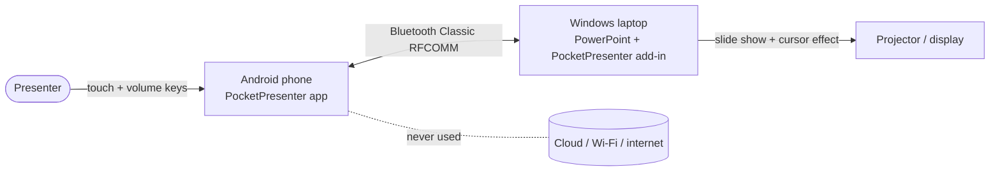
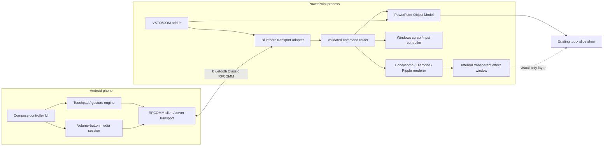
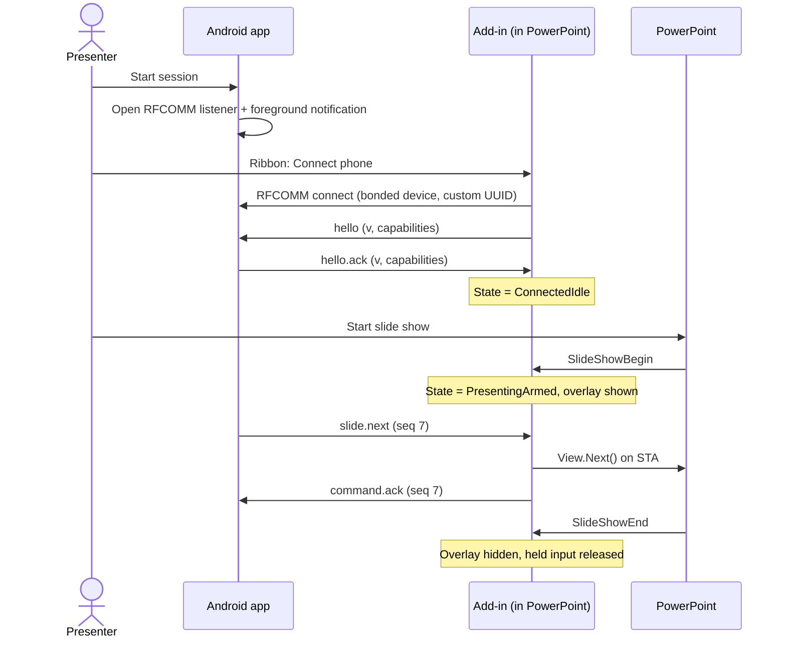
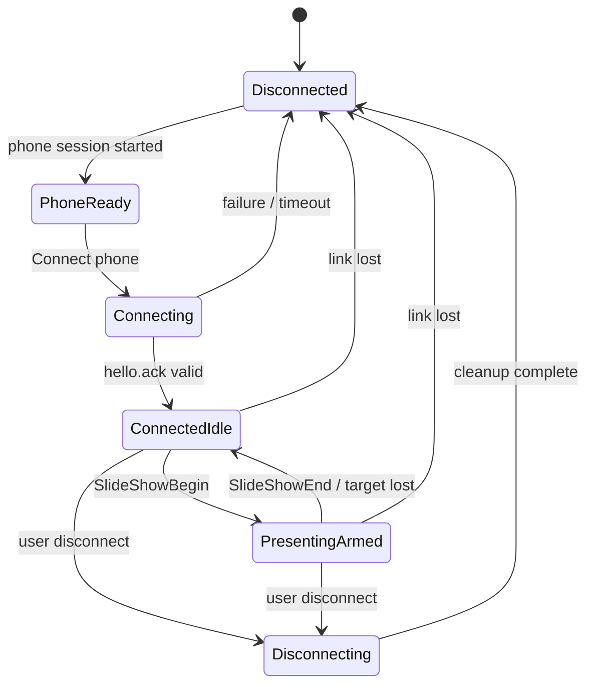

# PocketPresenter — Architecture

| | |
|---|---|
| **Status** | Proposed. Implementation must pass the Gate 0 feasibility gates (§16) before feature development continues. |
| **Version** | 1.2 |
| **Last reviewed** | 2026-10-18 |
| **Scope** | V1: Windows desktop PowerPoint + Android phone over Bluetooth Classic |
| **Related docs** | [PRD](prd.md) · [TRD](trd.md) · [Protocol](protocol.md) · [App flow](app_flow.md) · [UI/UX brief](ui_ux_brief.md) · [Local data model](backend_schema.md) · [Implementation plan](implementation_plan.md) · [Rules](rules.md) · [Feasibility report](feasibility-report.md) · [Decision log](decisions.md) · [Traceability](traceability.md) |

> **Reading guide.** Sections 1–3 explain *what* and *why*. Sections 4–12 define *how*. Sections 13–17 define risks, targets, gates and tests. Constraint IDs (`AC-*`) trace to the product requirement IDs (`FR-*`, `NFR-*`, `AT-*`) owned by the [PRD](prd.md); all are stable so issues, tests and PRs can reference them. If documents disagree, follow the precedence order in [docs/README.md](README.md).

## Table of contents

1. [Product definition](#1-product-definition)
2. [Requirements and non-goals](#2-requirements-and-non-goals)
3. [Architecture decision](#3-architecture-decision)
4. [Platform and technology choices](#4-platform-and-technology-choices)
5. [Component boundaries](#5-component-boundaries)
6. [Bluetooth connection and pairing](#6-bluetooth-connection-and-pairing)
7. [Command protocol (summary)](#7-command-protocol-summary)
8. [Android volume-button handling](#8-android-volume-button-handling)
9. [PowerPoint lifecycle and slide commands](#9-powerpoint-lifecycle-and-slide-commands)
10. [Cursor, touchpad and Draw Mode](#10-cursor-touchpad-and-draw-mode)
11. [Cursor-effect renderer](#11-cursor-effect-renderer)
12. [State model](#12-state-model)
13. [Threading model](#13-threading-model)
14. [Security and threat model](#14-security-and-threat-model)
15. [Failure handling and mitigations](#15-failure-handling-and-mitigations)
16. [Performance targets, feasibility gates and waves](#16-performance-targets-feasibility-gates-and-waves)
17. [Test plan and acceptance criteria](#17-test-plan-and-acceptance-criteria)
18. [Supported configurations](#18-supported-configurations)
19. [Open questions](#19-open-questions)
20. [Decisions not to reopen without evidence](#20-decisions-not-to-reopen-without-evidence)
21. [Glossary](#21-glossary)
22. [Official technical references](#22-official-technical-references)
23. [Revision history](#23-revision-history)

---

## 1. Product definition

PocketPresenter is an Android controller that operates an existing **Windows desktop Microsoft PowerPoint** presentation over **Bluetooth Classic**. A PowerPoint add-in owns the connection and presentation commands. While a slide show is running, the add-in displays a small transparent cursor-effect layer over the presentation.

The user must not need to open or manage a separate Windows companion application. The add-in runs inside PowerPoint. It may create an internal, temporary overlay window for graphics, but it must not launch a separate executable, put a second application in the taskbar, or require a cloud account, web server, Wi-Fi network, or internet connection.

### Core user experience

1. Open an existing `.pptx` file in PowerPoint as usual.
2. Pair the Android phone with Windows once through the operating system's Bluetooth settings.
3. Open the **PocketPresenter** ribbon group and connect the phone.
4. Start the slide show normally.
5. Use the phone as a wireless trackpad to move the actual Windows cursor and click. Optional Draw Mode lets the presenter draw/annotate on the current slide.
6. Change the cursor effect on the phone at any time without restarting the show.
7. Physical **Volume Up = next slide** and **Volume Down = previous slide**, including with the phone screen off on supported, tested devices.
8. When the slide show ends or the session disconnects, hide the effect layer and release any held input state.

### System context



## 2. Requirements and non-goals

### Architecture constraints

Product requirement IDs (`FR-*`, `NFR-*`) and acceptance targets (`AT-*`) are **owned by [prd.md](prd.md)**. This section lists the constraints the architecture must satisfy and traces each to the PRD. *(Version 1.1 of this document used its own `FR-*`/`NFR-*`/`SEC-*` numbers, which collided with the PRD's; they are replaced by `AC-*` here.)*

| ID | Architecture constraint | Priority | Traces to (PRD) |
|---|---|---|---|
| AC-01 | Integrate with existing **Windows desktop PowerPoint** through a VSTO/COM add-in. | P0 | FR-05, FR-09, principle 2 |
| AC-02 | Do not ship or run a separate Windows companion executable. | P0 | §7 non-goals, principle 2 |
| AC-03 | Use Bluetooth Classic RFCOMM for phone-to-PowerPoint command transport; no Wi-Fi dependency. | P0 | FR-01, principle 3 |
| AC-04 | Map physical Volume Up to next slide and Volume Down to previous slide. | P0 | FR-02, FR-08 |
| AC-05 | Move the Windows cursor using phone touch input. | P0 | FR-03 |
| AC-06 | Render three live-switchable, subtle effects around the cursor (**Honeycomb Pulse**: restrained hexagonal facets and local lift; **Diamond Facets**: restrained rhombus geometry; **Geometric Ripple**: minimal rings/contours responding to motion and clicks) plus an **Off** option. | P0 | FR-04 |
| AC-07 | Keep the actual cursor position independent of animation. Effects must never snap the cursor to a tile or delay input until an animation finishes. | P0 | FR-03, FR-04, NFR-01 |
| AC-08 | Keep PowerPoint's slide rendering, transitions, animations, embedded media, layouts and fonts under PowerPoint's control. | P0 | principle 1 |
| AC-09 | Do not modify or save changes to the source presentation just to render cursor effects. | P0 | principle 1 |
| AC-10 | Make connection, slide-show, error and disconnect states visible and understandable. | P0 | FR-07 |
| AC-11 | No blocking work on PowerPoint's UI thread (see section 13). | P0 | NFR-02 |
| AC-12 | Accept commands only from the selected, bonded, authenticated device/session; strictly allow-listed protocol; no remote execution of any kind (sections 7 and 14). | P0 | NFR-03 |
| AC-13 | Diagnostics never contain secrets or presentation content. | P0 | NFR-04 |
| AC-14 | Measured targets: median touch-to-cursor < 50 ms, p95 < 100 ms; effect at a capped 60 FPS and idle when nothing changes; 60-minute soak without leaks (section 16). | P0 | NFR-01, AT-02, AT-07 |
| AC-15 | Draw Mode for lines/annotations using PowerPoint's slide-show drawing API. | P1 | FR-06 |
| AC-16 | Left/right click, drag, scroll and configurable touchpad sensitivity. | P0/P1 | FR-03 |
| AC-17 | Optional cursor size/intensity controls and a reduced-motion setting. | P0/P1 | FR-04, NFR-05 |
| AC-18 | Supported-device matrix for other Windows/Office versions after the initial build is validated. | P1 | NFR-06 |

### Explicit non-goals for V1

- Replacing PowerPoint or implementing a full `.pptx` renderer.
- PowerPoint for the web, macOS PowerPoint, Linux, or remote presentation applications as launch targets.
- Cloud relay, user accounts, analytics, web dashboard, database or internet requirement.
- A second Windows UI application or helper EXE.
- Guaranteed screen-off volume interception on every Android OEM/model without testing.
- Guaranteeing the overlay appears in every application-window-only screen-sharing mode. This is a known limitation to test and document; display-level sharing/projected output is the primary target.
- Building a full 3D engine for a small cursor effect. A restrained 2.5D treatment is preferred.

## 3. Architecture decision

### Recommended design

**Android app + in-process PowerPoint VSTO add-in + internal transparent overlay window + Bluetooth Classic RFCOMM.**



The add-in creates and owns the overlay window. The overlay is an implementation detail, not a second Windows application. It should be click-through, non-activating, and visible only while an eligible PowerPoint slide show is active and the PocketPresenter session is armed.

### Why this option

- PowerPoint remains the real presentation engine, avoiding the cost and compatibility risk of rebuilding its file renderer.
- Native PowerPoint automation provides slide navigation without sending global keyboard shortcuts to whichever app happens to have focus.
- The small overlay is necessary for custom cursor geometry; PowerPoint's built-in cursor/laser-pointer options do not provide the requested switchable honeycomb and diamond effects.
- Bluetooth Classic transports low-volume commands and cursor deltas; the geometry is rendered locally on the Windows machine, not streamed from the phone.
- Keeping the add-in, Bluetooth transport, command routing and overlay in the PowerPoint process preserves the user's no-separate-app requirement.

### Alternatives considered

| Alternative | Why not for V1 |
|---|---|
| Standalone Windows companion app | Violates FR-02 and the "no second app" product promise. |
| Global keyboard injection (`Right`/`Left`) for slides | Goes to whichever window has focus; unsafe and unreliable. |
| BLE GATT for the command stream | Poorer fit for continuous low-latency pointer data than RFCOMM. |
| Wi-Fi/WebSocket transport | Violates FR-03; adds network setup and venue-network risk. |
| Office Web Add-in (Office.js) | No access to native Bluetooth or cursor/overlay primitives in-process. |
| Draw the effect inside the slide (shapes) | Modifies the presentation (violates FR-09) and cannot follow the real cursor smoothly. |
| Full 3D engine for effects | Disproportionate dependency and risk for a ~200 px effect. |

## 4. Platform and technology choices

### Android

- **Language:** Kotlin.
- **UI:** Jetpack Compose.
- **Settings:** Android DataStore or equivalent small local settings store.
- **Bluetooth:** Bluetooth Classic RFCOMM with a project-specific 128-bit service UUID.
- **Background operation:** user-started foreground service for the active Bluetooth presentation session, using the appropriate connected-device foreground-service type and permissions for the target Android version.
- **Volume keys while screen-off:** active `MediaSession` configured for remote volume handling through `VolumeProvider`; the volume callbacks emit slide commands rather than changing the phone's volume.
- **Permission handling:** request only required Bluetooth runtime permissions for the Android version. On Android 12+, account for `BLUETOOTH_CONNECT`, `BLUETOOTH_ADVERTISE`, and/or `BLUETOOTH_SCAN` according to the discovery and connection design.

Do not begin with an AccessibilityService workaround. It adds policy, user-consent and device-behavior complexity and is unnecessary if the active media-session route passes the device test.

### Windows / PowerPoint

- **Add-in model:** VSTO/COM add-in for Windows desktop PowerPoint.
- **Runtime:** .NET Framework 4.8, because the VSTO/COM add-in platform runs on .NET Framework rather than modern .NET in-process.
- **PowerPoint integration:** Microsoft Office PowerPoint Interop / PowerPoint Object Model.
- **Bluetooth abstraction:** `IBluetoothTransport` implemented inside the add-in process. The first implementation should use Windows Bluetooth Classic RFCOMM APIs compatible with an unpackaged desktop process. Gate 0 must verify connection and data transfer from the actual VSTO host. If the WinRT RFCOMM projection is problematic in the .NET Framework host, implement the same interface with native Windows Bluetooth/Winsock RFCOMM APIs; do not create a helper executable as a workaround.
- **Cursor movement:** Win32 `SetCursorPos` for controlled absolute positioning; use Win32 mouse input only for deliberate button-down/up and scroll actions where required.
- **Slide navigation:** call `SlideShowWindow.View.Next()` and `.Previous()` through PowerPoint Interop on the PowerPoint UI/STA thread. Do not rely on global `Right`/`Left` keyboard injection as the primary route.
- **Drawing:** use `SlideShowView.DrawLine` for Draw Mode after mapping phone coordinates to the current slide's point coordinates.
- **Effect renderer:** a small, per-pixel-alpha layered Win32 window created and owned by the add-in. Start with an off-screen `System.Drawing`/GDI+ bitmap renderer and `UpdateLayeredWindow`; the effect area is localized around the cursor. Avoid introducing a full 3D engine or large rendering dependency unless profiling proves necessary.
- **Window styles:** use the appropriate layered, click-through, non-activating and tool-window styles (for example, `WS_EX_LAYERED`, `WS_EX_TRANSPARENT`, `WS_EX_NOACTIVATE`, `WS_EX_TOOLWINDOW`) and verify input pass-through experimentally.

### Runtime boundary rules

- PowerPoint COM automation is accessed only on PowerPoint's main STA/UI thread.
- The Bluetooth receive loop runs off the UI thread and must never block PowerPoint.
- The input controller and renderer receive validated, immutable commands/state from the command router.
- Never call synchronous Bluetooth operations, wait on tasks, perform device discovery, or do expensive rendering on PowerPoint's UI thread.
- Every subscription to PowerPoint lifecycle events must be removed on add-in shutdown.

## 5. Component boundaries

### Android modules

```text
android/
  app/
    ui/                 Compose screens, connection state, effect selector
    input/              Touchpad gestures, click/drag/scroll state machine
    presentation/       Volume-to-slide mapping, control modes
    bluetooth/          RFCOMM server/socket, protocol codec, reconnect handling
    session/            User-started foreground service and MediaSession
    settings/           Sensitivity, haptics, effect preference, pairing metadata
```

### PowerPoint add-in modules

```text
windows-addin/
  AddIn/                VSTO startup, shutdown, ribbon, UI-thread dispatcher
  PowerPoint/           Slide-show lifecycle, slide commands, Draw Mode mapping
  Bluetooth/            RFCOMM transport, pairing/trust state, framed protocol
  Protocol/             Message schema, validation, sequence numbers, acknowledgements
  Input/                Cursor movement, click, drag and scroll
  Overlay/              Window lifecycle, monitor placement, effect renderer
  Effects/              HoneycombPulse, DiamondFacets, GeometricRipple
  Settings/             Local per-user settings
  Diagnostics/          Local structured diagnostics with secrets omitted
```

No server, database, cloud API or web frontend is required.

### Dependency rules

- `Protocol` has no dependency on Bluetooth, PowerPoint, Input or Overlay (pure, unit-testable).
- `Effects` depends only on a cursor/time/settings input and a drawing surface; never on Bluetooth or PowerPoint.
- Only `PowerPoint/` may touch Office Interop types, and only via the UI-thread dispatcher.
- Only `Input/` may call cursor or mouse Win32 APIs.
- Only `Overlay/` may create or destroy the overlay window.

## 6. Bluetooth connection and pairing

### User flow

1. User pairs the phone and Windows laptop once using the normal OS Bluetooth pairing UI.
2. User opens PocketPresenter on Android and taps **Start session**. The app starts its RFCOMM listener and the visible connected-device foreground notification.
3. In PowerPoint, the user selects **PocketPresenter → Connect phone**, chooses the paired phone if needed, and connects to its advertised custom RFCOMM service.
4. The add-in validates the session handshake and displays **Connected**.
5. When a slide show begins, the add-in arms the overlay and presentation commands.
6. Disconnect closes the RFCOMM connection, hides the overlay, ends held mouse/key states and stops the Android session service after confirmation.

The add-in must not automatically start controlling the system cursor merely because the phone is paired. Pairing and active control are separate states.



### Transport requirements

- Use Bluetooth Classic RFCOMM, not BLE GATT, for the primary continuous command stream.
- Use authenticated/encrypted OS Bluetooth pairing where supported, and accept commands only from the selected trusted paired device/session.
- Use a fixed application service UUID and a versioned command protocol.
- Do not automatically replay stale commands after reconnecting.
- Reconnection may be attempted with bounded backoff, but user-visible state must show when control is not currently active.
- The phone must not keep sending pointer deltas while disconnected. Clear active touch, drag and pressed-button states on disconnect.
- If Windows cannot connect to the RFCOMM service inside the VSTO host in Gate 0, stop and fix the transport integration before building cursor effects.

## 7. Command protocol (summary)

The full wire specification, including examples, limits and error codes, lives in [protocol.md](protocol.md). Summary:

Use small UTF-8 JSON messages, one complete JSON object per newline, over the ordered RFCOMM byte stream. The decoder must handle partial reads and multiple messages in one read; a Bluetooth read boundary is not a message boundary.

Every message includes the fields below. After the handshake, every message also carries the session ID `sid` chosen by the phone, so late frames from an earlier session can never execute (see [protocol.md §2](protocol.md#2-envelope)).

```json
{
  "v": 1,
  "sid": "3f2b8c1e-5d7a-4c0e-9b1d-2a6f4e8c7d10",
  "seq": 42,
  "type": "slide.next",
  "payload": {}
}
```

### Supported message types

| Type | Purpose | Delivery behavior |
|---|---|---|
| `hello` / `hello.ack` | Negotiate protocol version and capabilities | Required before commands are enabled |
| `session.ping` / `session.pong` | Detect stale/dead connection | Periodic, low traffic |
| `state.request` / `state.update` | Return connection, slide-show and effect state | Latest state wins |
| `pointer.delta` | Relative touchpad movement | Ordered; aggregate short bursts without dropping total delta |
| `pointer.button` | Left/right button down/up | Ordered; release all held buttons on failure |
| `pointer.scroll` | Scroll delta | Ordered; aggregate small scroll bursts where safe |
| `slide.next` | Next slide | Ordered and de-duplicated by session sequence/command ID |
| `slide.previous` | Previous slide | Ordered and de-duplicated by session sequence/command ID |
| `effect.set` | Choose `honeycomb`, `diamond`, `ripple` or `off`; set intensity/scale | Latest state wins |
| `draw.start`, `draw.point`, `draw.end` | Draw Mode gesture | Ordered, with bounded point batches |
| `command.ack` / `command.error` | Confirm result or report reason | Required for discrete commands |

Validation rules:

- Reject unknown command types, incompatible protocol versions, malformed messages, invalid enum values, excessive message sizes and out-of-range numeric values.
- Never accept arbitrary shell commands, arbitrary PowerShell, arbitrary keystroke strings, file operations or generic remote-execution commands.
- Give non-idempotent slide commands a sequence number/command ID so retries cannot accidentally advance twice.
- Do not block on acknowledgements for every high-frequency pointer sample. Use state coalescing for effects and preserve ordered total movement for pointer deltas.
- Keep message payloads small. Do not transmit graphics frames or effect geometry over Bluetooth.

## 8. Android volume-button handling

The mapping is fixed:

- **Volume Up → `slide.next`**
- **Volume Down → `slide.previous`**

Implementation plan:

1. The user explicitly starts a presentation session while the app is foregrounded.
2. Start the appropriate connected-device foreground service and keep a visible notification with a Stop action while the control session is active.
3. Activate a `MediaSession` and configure remote volume handling with `VolumeProvider`.
4. Convert volume-adjust callbacks into one slide command each, sending them over the same active RFCOMM session.
5. Keep the session active while the screen is off, subject to Android version and device/OEM behavior.
6. Deduplicate repeated/retried command IDs, but do not debounce so aggressively that deliberate repeated button presses stop working.
7. If the session is not connected, do not silently change the mapping; show a disconnected state when the screen is available and avoid queuing stale slide commands.

**Pocket Mode (phone UX).** The phone-side mode that prepares a session for screen-off use is called *Pocket Mode* ([app_flow.md Screen H](app_flow.md#screen-h--pocket-mode)). It must state whether screen-off volume control is validated, not validated or unsupported on this device, and must never promise more than the Gate 0.3 results show.

**Implementation hypotheses to verify in Gate 0** (not assumptions): Android generally routes hardware volume keys to the most recently active media session, which typically requires the session to be active and to report a playback state. Some devices may additionally require the session to appear as "playing" (for example, by holding audio focus or playing silent audio) before they deliver volume keys to the remote `VolumeProvider` with the screen off. If that is needed, record it in the feasibility report together with its battery and UX impact, and treat it as a deliberate design revision rather than a silent workaround.

**Required feasibility test:** With the phone paired and session active, press both physical volume buttons with the display on, locked, and screen-off. Verify that the phone does not change media volume, that the right command arrives exactly once, and that another active media app does not steal the volume session. Repeat after screen-off idle, app backgrounding and device battery restrictions. A result on one device is not proof for every Android OEM.

## 9. PowerPoint lifecycle and slide commands

- On add-in load: initialize the ribbon and services, but do not open Bluetooth, move the cursor or show the overlay automatically.
- On `SlideShowBegin`: identify the active slide-show window and target display. If the phone is connected and the user has armed the session, show the overlay and activate presentation control.
- On `SlideShowNextSlide`: refresh local slide/session state if required; do not modify slide content for the cursor effect.
- On `SlideShowEnd`: immediately hide the overlay, stop effect animation and disable slide commands until a new eligible show begins. Leave no cursor trails on the desktop.
- `slide.next` / `slide.previous`: run only if a valid PowerPoint slide-show window is active. Dispatch onto the PowerPoint STA thread and call the relevant `SlideShowWindow.View` navigation method. Return a useful error if there is no active show; never send the command to another application.
- At the final slide, follow defined PowerPoint behavior; do not synthesize extra commands that might close the show unintentionally.
- When PowerPoint loses the active target, the display changes, the show is minimized, or the user Alt-Tabs away, hide/suspend the overlay until the target is valid again.

## 10. Cursor, touchpad and Draw Mode

### Pointer Mode (V1)

- Single finger: relative cursor movement.
- Tap: left click.
- Two-finger tap: right click.
- Two-finger movement: scroll.
- Long-press then move: left-button drag, with a clear visual state on the phone.
- Touch release, disconnect, app pause or timeout must always release held mouse buttons.
- Sensitivity and acceleration are configurable. The animation must not affect cursor movement math.

### Draw Mode (planned after Pointer Mode is stable)

- Phone drag samples are transformed from the touch surface to slide coordinates.
- PowerPoint's `SlideShowView.DrawLine` is invoked on the PowerPoint STA for successive line segments.
- Treat drawing as a slideshow annotation, not as an edit to original slide shapes, unless a later version explicitly implements slide-object editing.
- Provide an explicit Exit Draw Mode action. A normal cursor movement must never unexpectedly draw.
- Bound/batch points so drawing remains responsive without saturating the COM message queue.

The normal Windows cursor remains visible in V1. The visual effect is an enhancement around it, not a replacement that risks losing the pointer.

## 11. Cursor-effect renderer

### Shared visual rules

- Small, localized effect centered near the actual Windows cursor; start with an effect radius of roughly 60–100 px (about 120–200 px across) drawn inside a roughly 180–240 px square render canvas, then tune by projector tests ([ui_ux_brief.md §6](ui_ux_brief.md#6-the-three-windows-cursor-effects)).
- Restrained cyan/teal/steel-blue accents on a dark/transparent surface; no full-screen glow or permanent animated wallpaper.
- Effects settle when the pointer stops; no animation should continue needlessly while idle.
- Respect `intensity`, `scale`, and `reducedMotion` settings.
- The `off` setting draws nothing: the overlay stays hidden or fully transparent and the native cursor is unaffected.
- Maintain a stable center marker and do not snap pointer position to the geometry.
- Use the same cursor coordinate, time base and fade rules across all three effects so switching styles does not jump the cursor.

### Variants

| # | Effect | Description |
|---|---|---|
| 1 | **Honeycomb Pulse** | Small hexagonal facets, slight pseudo-elevation, brief local edge-light pulse. |
| 2 | **Diamond Facets** | Small rhombus/diamond facets with low-amplitude directional shading. |
| 3 | **Geometric Ripple** | Two or three faint geometric rings/contours that expand and fade after movement/click. |

These are restrained **2.5D** effects using shape, shading, alpha and timed motion. Real extruded 3D geometry and a game engine are not justified for V1.

### Rendering and overlay rules

- Render in the Windows process through one internal transparent layered window.
- The window must be non-activating and click-through; it must not intercept or replace the native mouse click.
- Follow the actual system cursor using native cursor-position queries. Render at a capped target of 60 frames per second and avoid work when nothing visibly changes.
- Draw a small off-screen bitmap and update the layered window using per-pixel alpha. Do not create one UI element or one child window per hexagon.
- Keep the renderer independent of slide navigation and Bluetooth I/O.
- Bind effect visibility to the actual slideshow lifecycle and target monitor. Hide the overlay before control returns to PowerPoint edit mode or another application.
- Test external monitors, Presenter View, display scaling, slide-show transitions, video playback, Alt-Tab, and screen-capture behavior.
- Declare the add-in per-monitor DPI behavior explicitly and convert between physical pixels and PowerPoint points in one place, so the overlay, `SetCursorPos` and Draw Mode coordinates agree at 100%–250% scaling.

### Screen-sharing limitation

A cursor effect rendered in a separate transparent window can appear on a physical projector or a shared full display, but may be omitted when a meeting app captures only the PowerPoint application window. Do not claim universal application-window capture support. If application-window-only sharing becomes a mandatory target, treat an integrated in-slide rendering path or a different capture-compatible design as a separate architecture decision; do not silently compromise the PowerPoint-first architecture.

## 12. State model



State names map to wire values and user-facing labels as follows (full control matrix: [app_flow.md §3](app_flow.md#3-state-driven-controls)):

| Internal state | Wire `link` value | Phone label | Notes |
|---|---|---|---|
| `Disconnected` | `disconnected` | Not connected | |
| `PhoneReady` | `disconnected` | Waiting for PowerPoint | Phone session started, no link yet |
| `Connecting` | `disconnected` | Connecting… | |
| `ConnectedIdle` | `connected_idle` | Connected — start the slide show | Controls disabled |
| `PresentingArmed` | `presenting_armed` | Presenting | Overlay and control active |
| `Disconnecting` | `disconnected` | Ending session… | |

*Reconnecting* and *Error* are presentation states layered on top of link loss with bounded retry; they never imply control is active.

Failure transitions from any connected state must:

1. Stop accepting new input commands.
2. Release all held mouse buttons and keys.
3. Hide the effect overlay and stop rendering.
4. Clear touch/drag/drawing state and stale command queues.
5. Update the ribbon/phone connection state.
6. Close dead Bluetooth sockets and apply bounded reconnection only if the user has not explicitly disconnected.

Connection state, phone session state and presentation state are separate values. A phone may remain connected while PowerPoint is not presenting; that must not make the overlay visible.

## 13. Threading model

| Thread | Owns | Must never |
|---|---|---|
| PowerPoint UI/STA | All Office Interop calls, ribbon callbacks, lifecycle events | Block on Bluetooth, wait on tasks, render effect frames |
| Bluetooth I/O (background) | RFCOMM read/write loop, frame decoding, validation | Touch COM objects |
| Render (background timer, ≤ 60 Hz) | Off-screen bitmap, `UpdateLayeredWindow` | Touch COM objects; run while idle |
| Input dispatch | `SetCursorPos`, button/scroll injection | Run unvalidated or stale commands |

Data crosses threads only as immutable, validated messages through bounded queues. Queue overflow policy is explicit per message type (coalesce pointer deltas and effect state; never drop slide commands silently; drop oldest draw points).

## 14. Security and threat model

PocketPresenter lets a nearby device move the cursor and change slides on a laptop. Treat that as a security boundary.

| Threat | Mitigation |
|---|---|
| Nearby unpaired device tries to control the laptop | Bonded, encrypted OS pairing required; add-in accepts only the user-selected device (NFR-03). |
| Compromised or buggy phone sends hostile payloads | Strict allow-listed schema, size and rate limits, range checks; no shell, PowerShell, file or arbitrary-keystroke commands (NFR-03). |
| Stale or replayed commands after reconnect | Per-session sequence numbers; queues cleared on disconnect; no replay. |
| Control continues unexpectedly after pairing | Pairing ≠ control; explicit user action to connect and an armed slide-show state required. |
| Control leaks to another application | Slide commands use the PowerPoint object model only; cursor input is active only while armed. |
| Sensitive data in logs | Diagnostics omit secrets, device addresses beyond what is needed, and presentation content (NFR-04). |

**Proposed hardening (to evaluate in Wave 2, not yet a requirement):** a first-connection confirmation prompt in PowerPoint showing the phone's name, and an optional short numeric confirmation code shown on both devices during the first handshake. Record the outcome in [decisions.md](decisions.md).

## 15. Failure handling and mitigations

| Failure mode | Mitigation / required behavior |
|---|---|
| RFCOMM cannot connect inside the VSTO host | Stop feature work at Gate 0; fix the in-process transport adapter. Do not add a helper executable. |
| Android volume events go to system volume or another media app | Test `MediaSession`/`VolumeProvider` with the screen off and competing media sessions on the target device. Mark unsupported device configurations clearly; never promise universal capture. |
| Bluetooth drops mid-drag | Release buttons, clear gesture state, hide overlay if session is not valid, and never replay stale commands after reconnection. |
| Duplicate Next/Previous | Per-session sequence/command ID deduplication; no blind retries of non-idempotent commands. |
| PowerPoint show is not active | Reject command with `NO_ACTIVE_SLIDESHOW`; do not send global shortcuts to another app. |
| Overlay blocks mouse clicks or steals focus | Click-through and no-activate styles; test real clicks during Gate 0 and automated smoke tests. |
| Overlay stays on the desktop after slideshow ends | PowerPoint lifecycle events plus a watchdog; hide on end, disconnect, target loss, and add-in shutdown. |
| Overlay appears on wrong monitor or offset | Explicit target-display selection/fallback; use Windows monitor APIs; test different DPI/scaling levels and Presenter View. |
| Cursor moves too slowly or jumps | Calibrate sensitivity; keep input and animation separate; measure touch-to-cursor latency. |
| Renderer stutters | Small bitmap, pooled resources, capped 60 FPS, no per-tile UI controls, pause when idle, profile on target laptop. |
| PowerPoint freezes | No blocking I/O/rendering on the Office STA; queue only validated commands; bound queues and point batches. |
| COM call from wrong thread | Enforce one PowerPoint STA dispatcher for all PowerPoint Interop access. |
| User Alt-Tabs away | Suspend the overlay and reject presentation commands until the correct slide-show target is active again. |
| App/add-in shuts down during drag | Best-effort release of input state on every shutdown/disconnect/error path; never keep a hidden overlay alive. |
| Bluetooth permissions denied | Explain required permission and offer a re-open-settings action; do not crash or loop prompts. |
| Windows add-in is disabled by Office | Provide a clear installation/repair guide and logs; no silent fallback to global input control. |
| Meeting app omits effect from window capture | Document display-capture as the supported V1 share path; evaluate an integrated PowerPoint rendering option only if needed. |
| An untrusted device sends commands | Bonded-device check, authenticated/encrypted Bluetooth where possible, strict allow-listed protocol, size/rate limits, no generic remote execution. |
| Laptop sleep/resume | Treat resume as link loss: full cleanup, then require explicit or bounded reconnect. |

## 16. Performance targets, feasibility gates and waves

### Performance and reliability targets

Engineering targets to measure on the actual laptop and phone, not unconditional guarantees:

- Cursor motion: median phone-touch to visible-cursor response below 50 ms and 95th percentile below 100 ms under a normal Bluetooth connection.
- Effect rendering: stable 60 FPS while the effect is active on a normal 1080p presentation display; gracefully reduce detail/frame rate on slower systems.
- Slide buttons: one command per physical press, ordered, with duplicate protection.
- Bluetooth loss: visible disconnected state quickly; no stale movement replay after reconnection.
- CPU/GPU/battery: no continuous full-screen redraw; animation work stops or becomes idle when no effect is changing.
- Long session: run a 60-minute presentation soak test without memory growth, stuck input states, unbounded queues or overlay leaks.

### Feasibility gates

Do not build all features at once. **No new feature wave starts until the existing gate passes.**

#### Gate 0 — Three proof-of-concepts (mandatory)

1. **Bluetooth:** Android RFCOMM listener and a minimal client inside the PowerPoint VSTO process can pair/connect, exchange commands, and recover from disconnect. No separate EXE.
2. **Overlay:** a basic click-through layered window can follow the cursor over a real PowerPoint slide show and projector output without stealing focus or blocking clicks; it hides on `SlideShowEnd`.
3. **Volume buttons:** Volume Up/Down reach the correct command once each while the Android display is off on the target phone, without changing media volume in the test conditions.

**Gate 0 exit criteria:** all three pass on the actual target laptop, installed desktop PowerPoint version, Bluetooth adapter and Android phone. If one fails, fix or formally revise that part of the design before continuing. Results are recorded in [feasibility-report.md](feasibility-report.md).

### Implementation waves

The [implementation plan](implementation_plan.md#how-phases-map-to-architecture-waves) breaks these waves into numbered phases and tasks. Per-device results go in [../tests/manual-test-matrix.md](../tests/manual-test-matrix.md).

| Wave | Goal | Scope |
|---|---|---|
| 1 | Minimal usable controller | VSTO ribbon with Connect/Disconnect and status; Android Bluetooth session and handshake; next/previous via object model; basic cursor movement, left click, safe disconnect cleanup; simple cursor marker only. |
| 2 | Production pointer behavior | Right click, scroll, drag, sensitivity, connection recovery; state machine, sequence IDs, acknowledgements, diagnostics, tests; multi-monitor targeting and overlay show/hide correctness. |
| 3 | Three cursor effects | Honeycomb Pulse, Diamond Facets, Geometric Ripple; live switching, intensity/scale, reduced motion; profiling, contrast and projector tests. |
| 4 | Draw Mode and hardening | `SlideShowView.DrawLine` drawing; 60-minute soak; disconnect, screen-off and Office-recovery tests; installer validation. |
| 5 | Release packaging | VSTO installer, signing where appropriate, repair/uninstall; supported Windows/Office bitness and tested Android devices documented; no runtime helper executable, service, cloud account or Wi-Fi setup. |

## 17. Test plan and acceptance criteria

### Automated tests

- Protocol encoder/decoder with partial messages, multi-message buffers, malformed JSON, oversize inputs, unknown types and invalid numeric values.
- Session state transitions and reconnect cleanup.
- Command ID/sequence deduplication.
- Gesture-state tests: tap vs double tap vs long-press drag vs two-finger scroll.
- Effect selection and shared cursor coordinate continuity.
- PowerPoint command wrapper tests using a fake interface; COM UI-thread dispatcher tests.
- Shutdown tests proving overlay and timers are disposed and no button remains held.

### Manual hardware tests

- Actual Android phone, Windows Bluetooth adapter and installed desktop PowerPoint.
- Physical volume buttons: screen on, app foreground, app background, locked, screen-off, competing media session active, Bluetooth disconnected/reconnected.
- PowerPoint editor, slideshow on laptop display, external/projector display, Presenter View, different scale factors and multiple monitors.
- Bright and dark slides, rapid cursor movement, clicks, draw strokes, slide transitions, embedded video, final slide, Escape/end, Alt-Tab, minimize/restore.
- Bluetooth off/on, range loss, laptop sleep/resume, app force-stop, PowerPoint close/reopen, add-in disabled/re-enabled.
- Display-level screen sharing vs application-window-only screen sharing.

### Release acceptance criteria

- The three Gate 0 proof-of-concepts pass.
- Volume Up and Volume Down behave as specified on every declared supported device/configuration.
- The overlay never blocks intended clicks and does not steal focus during a slideshow.
- PowerPoint slide navigation is scoped to an active slide show and cannot control another app accidentally.
- All three effects can be switched live; cursor position remains continuous.
- Disconnect, app pause, Bluetooth loss and slideshow exit release all held input and hide the overlay.
- No source presentation is unintentionally modified or saved by cursor effects.
- No blocking work runs on the PowerPoint UI thread.
- Installation/uninstallation does not require launching a separate Windows companion.

## 18. Supported configurations

Fill this matrix from real test results. Do not list a configuration as supported until it has passed the relevant tests.

| Component | Target for V1 | Status |
|---|---|---|
| Windows | Windows 10/11, 64-bit | To be validated |
| PowerPoint | Desktop PowerPoint (Microsoft 365 / 2019+), bitness to be declared | To be validated |
| Android | Android 12+ (API 31+) initially; older versions evaluated later | To be validated |
| Bluetooth | Classic (BR/EDR) adapter on Windows; phone with Classic support | To be validated |
| Display | Laptop display, external/projector, Presenter View | To be validated |
| Screen sharing | Display-level capture supported; window-level capture not guaranteed | Known limitation |

## 19. Open questions

| # | Question | Resolved by |
|---|---|---|
| Q1 | Does WinRT RFCOMM work reliably from a .NET Framework 4.8 VSTO host, or is native Winsock RFCOMM needed? | Gate 0.1 |
| Q2 | Does screen-off volume interception work with `MediaSession`/`VolumeProvider` alone on the target phone, or is an active playback state required? | Gate 0.3 |
| Q3 | Which Windows monitor/DPI model gives consistent overlay, cursor and Draw Mode coordinates? | Wave 2 |
| Q4 | Is a first-connection confirmation code worth the UX cost? | Wave 2 |
| Q5 | Which VSTO signing/installer approach fits the intended distribution channel? | Wave 5 |
| Q6 | Is application-window-only sharing a mandatory target? If yes, a separate architecture decision is required. | Product decision |
| Q7 | Should a held-button watchdog release buttons after ~3 s of silence (phone pings every 1 s while a button is held)? ([protocol.md §7](protocol.md#7-disconnect-behaviour)) | Wave 2 (plan task P2-09) |
| Q8 | Is two-finger tap the primary right-click, with a visible button as fallback? ([PRD PQ3](prd.md#13-open-questions)) | Usability testing |

## 20. Decisions not to reopen without evidence

- **PowerPoint-first:** keep existing PowerPoint as the slide renderer.
- **No separate Windows executable:** the add-in owns Bluetooth and overlay resources inside the PowerPoint process.
- **Bluetooth Classic RFCOMM:** primary local transport; Wi-Fi is not a runtime dependency.
- **Volume mapping fixed:** Up = next, Down = previous.
- **Native cursor + local effect:** do not make cursor position depend on animation or pattern cells.
- **Three subtle patterns:** Honeycomb, Diamond, Geometric Ripple.
- **Validate first:** no broad feature work until Gate 0 passes.

See [decisions.md](decisions.md) for rationale and the process for reopening a decision.

## 21. Glossary

| Term | Meaning |
|---|---|
| RFCOMM | Serial-port emulation over Bluetooth Classic; an ordered byte stream. |
| VSTO | Visual Studio Tools for Office; .NET Framework add-ins hosted inside Office. |
| STA | Single-threaded apartment; the COM threading model PowerPoint's UI thread uses. |
| Overlay | The add-in-owned, transparent, click-through window that draws the cursor effect. |
| Armed | Phone connected, user control enabled, and an eligible slide show running. |
| Pocket Mode | Phone-side mode that keeps physical volume buttons usable with the display off, on validated devices only. |
| Session ID (`sid`) | Random UUID chosen by the phone per connection; carried on every message after the handshake. |
| Gate 0 | The three mandatory feasibility proofs before any feature work. |
| `MediaSession` / `VolumeProvider` | Android APIs that let an app receive hardware volume events for a remote playback target. |

## 22. Official technical references

API availability and permission rules must be checked against the SDKs/Office versions used when building and releasing.

1. Microsoft — VSTO add-in architecture: https://learn.microsoft.com/en-us/visualstudio/vsto/architecture-of-vsto-add-ins?view=visualstudio
2. Microsoft — VSTO and .NET Framework runtime guidance: https://learn.microsoft.com/en-us/visualstudio/vsto/visual-studio-tools-for-office-runtime?view=visualstudio
3. Microsoft — Bluetooth RFCOMM APIs for Windows apps/desktop applications: https://learn.microsoft.com/en-us/windows/apps/develop/devices-sensors/send-or-receive-files-with-rfcomm
4. Microsoft — PowerPoint `SlideShowWindow`: https://learn.microsoft.com/en-us/office/vba/api/powerpoint.slideshowwindow
5. Microsoft — PowerPoint `SlideShowView.DrawLine`: https://learn.microsoft.com/en-us/office/vba/api/powerpoint.slideshowview.drawline
6. Microsoft — PowerPoint `SlideShowView.PointerType`: https://learn.microsoft.com/en-us/office/vba/api/powerpoint.slideshowview.pointertype
7. Microsoft — Layered window features and alpha/click-through behavior: https://learn.microsoft.com/en-us/windows/win32/winmsg/window-features
8. Microsoft — `SetLayeredWindowAttributes`: https://learn.microsoft.com/en-us/windows/win32/api/winuser/nf-winuser-setlayeredwindowattributes
9. Android — Bluetooth permissions: https://developer.android.com/develop/connectivity/bluetooth/bt-permissions
10. Android — Foreground-service types and connected-device guidance: https://developer.android.com/develop/background-work/services/fgs/service-types
11. Android — Restrictions on starting foreground services from the background: https://developer.android.com/develop/background-work/services/fgs/restrictions-bg-start
12. Android — `MediaSession.setPlaybackToRemote` / remote volume handling: https://developer.android.com/reference/android/media/session/MediaSession

## 23. Revision history

| Version | Date | Change |
|---|---|---|
| 1.0 | 2026-10-18 | Initial proposed architecture. |
| 1.1 | 2026-10-18 | Added requirement IDs, alternatives considered, sequence and state diagrams, threading model, threat model, supported-configuration matrix, open questions, glossary; moved wire details to `protocol.md`; added Gate 0 hypotheses for volume handling and DPI coordinate handling. No locked decision changed. |
| 1.2 | 2026-10-18 | Reconciled with the full documentation pack: replaced colliding `FR/NFR/SEC` IDs with `AC-*` constraints traced to the PRD; added `off` effect value and `sid` session ID to the protocol summary; clarified effect radius vs render canvas; added state-name mapping table; added Pocket Mode and Session ID to glossary; added open questions Q7–Q8; linked implementation plan and test matrix. No locked decision changed. |

---

## Implementation instruction

Treat this file as the source of truth for V1 scope. First build only the Gate 0 proof-of-concepts. Record test results and any platform blocker in `docs/feasibility-report.md`. Do not continue to later waves until Gate 0 passes on the real target hardware and PowerPoint installation. Do not add a separate Windows helper executable, cloud service or Wi-Fi transport without an explicit architecture decision.
